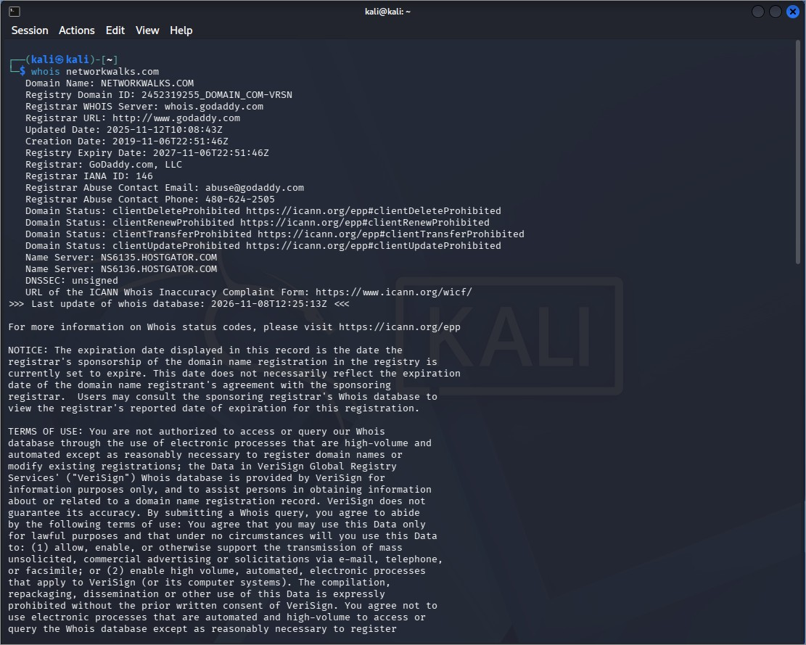
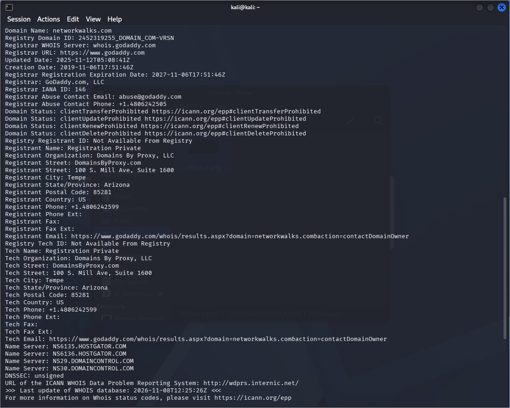
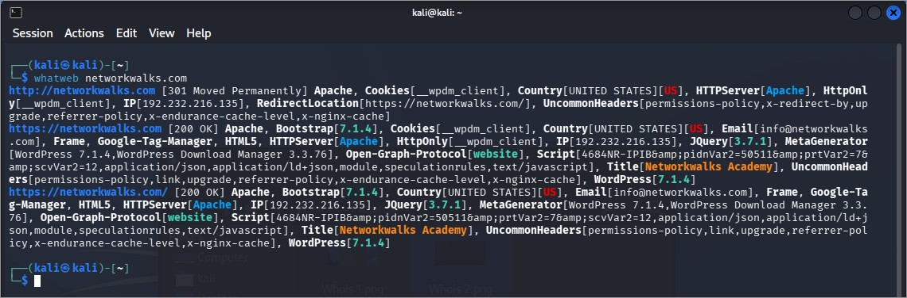
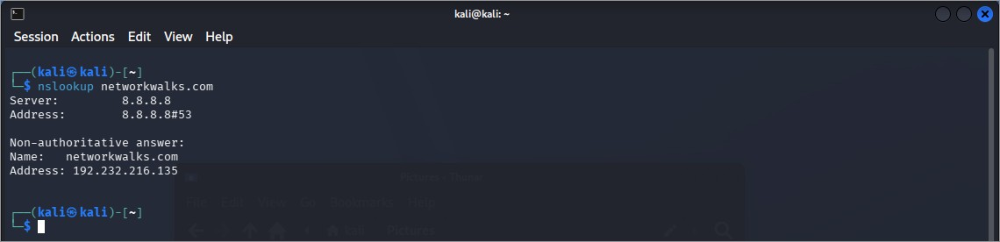
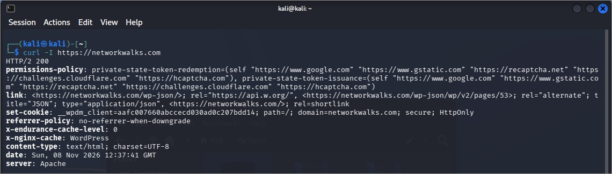
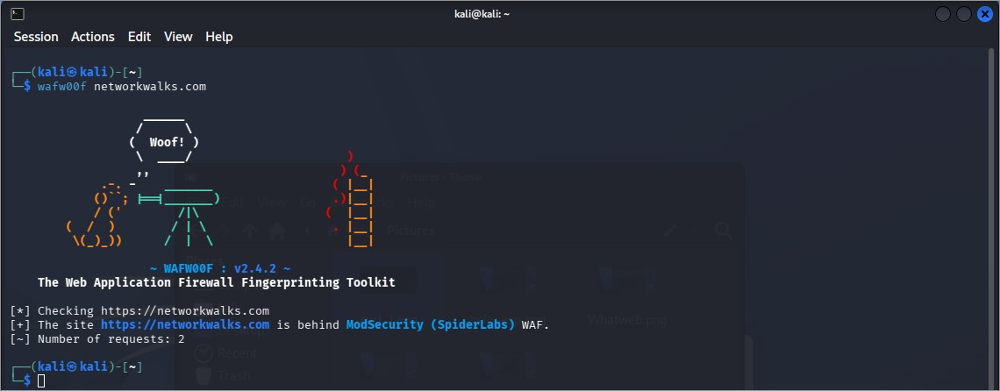
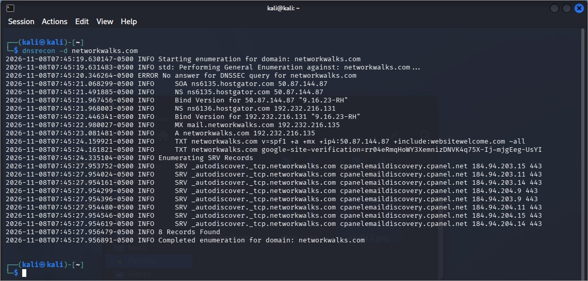

# Module 1 – Footprinting with Multiple Kali Tools

**Target:** networkwalks.com (written authorization) · **Date:** 8 Nov 2026 · **Environment:** Kali Linux VM
All commands completed without errors.

## Commands and results

| Tool | Command | Key observations |
|------|---------|------------------|
| WHOIS | `whois networkwalks.com` | Registrar GoDaddy; created 6 Nov 2019, expires 6 Nov 2027; registrant behind a privacy proxy; transfer/update/renew/delete locks set; DNSSEC unsigned; name servers at HostGator, plus extra DomainControl name servers in the registrar record. |
| WhatWeb | `whatweb networkwalks.com` | Apache, WordPress 7.1.4, WP Download Manager 3.3.76, jQuery 3.7.1, Google Tag Manager, IP 192.232.216.135, email info@networkwalks.com. |
| nslookup | `nslookup networkwalks.com` | Resolves to 192.232.216.135 (via 8.8.8.8). |
| curl | `curl -I https://networkwalks.com` | HTTP/2 200; Apache; REST API at `/wp-json/` advertised; cache headers visible; no HSTS, CSP, X-Frame-Options or X-Content-Type-Options observed. |
| wafw00f | `wafw00f networkwalks.com` | ModSecurity (SpiderLabs) WAF. |
| DNSRecon | `dnsrecon -d networkwalks.com` | 8 records; both name servers report BIND 9.16.23-RH; web and mail on one IP; SPF ends in `~all`; 8 cPanel autodiscover SRV records. |

## Takeaways
A shared HostGator/cPanel environment hosts a WordPress site. The WAF and registration privacy are good controls. The main gaps are missing security headers, soft-fail SPF, unsigned DNSSEC and version disclosures.

## Evidence

*Figure 1.1 – WHOIS lookup – registry record*

*Figure 1.2 – WHOIS lookup – registrar record*

*Figure 1.3 – WhatWeb*

*Figure 1.4 – nslookup*

*Figure 1.5 – curl -I headers*

*Figure 1.6 – wafw00f*

*Figure 1.7 – dnsrecon -d*
