# Module 2 – Footprinting with the Google Hacking Database (GHDB)

**Scope:** publicly indexed search results · **Date:** 8 Nov 2026
**Conduct:** passive viewing only. No login attempts, credential guessing, brute force, pan/tilt/zoom, setting changes or downloads. No footage recorded beyond two reference screenshots (thumbnails blurred). Hosts and IPs masked; no owners contacted.

## Task 1 – Exposed security cameras
Searched the term `cam` on Exploit-DB's GHDB, ran selected dorks in Google and opened ten results.

| No. | Host (masked) | Dork | Observation |
|-----|---------------|------|-------------|
| 1 | 109.233.xxx.xxx:8080 | `intitle:"webcamXP" inurl:8080` | webcamXP 5 multi-view; 7 camera tiles, live; "Not logged in" |
| 2 | Dynamic-DNS host :8080 | `intitle:"my webcamXP server!" inurl:":8080"` | Live feed, no login |
| 3 | 109.164.xxx.xxx | `"Camera Live Image" inurl:"guestimage.html"` | Guest image page, live, no login |
| 4 | 185.186.xxx.xxx:10082 | same | Guest image page, live, no login |
| 5 | 173.69.xxx.xxx:9001 | same | Guest image page, live, no login |
| 6 | 95.255.xxx.xxx:8080 | `intitle:webcam 7 inurl:8080 -intext:8080` | Live feed, no login |
| 7 | 109.206.xxx.xxx:8080 | same | Live feed, no login |
| 8 | 99.114.xxx.xxx:8080 | `"Active Webcam Page" inurl:8080` | Webcam 7; 2 tiles; "Not logged in" |
| 9 | ipcamlive.com hosted stream | same | Private premises appeared; probable unintended exposure |
| 10 | ipcamlive.com hosted stream | same | Private premises appeared; probable unintended exposure |

## Task 2 – Open directories with mathematics PDFs
Dork: `intitle:index.of "parent directory" mathematics pdf`. Ten listings were browsed (nothing downloaded). They are described by type only (university, school, personal server, academic repository, non-profit); one was a large textbook library that likely involves copyrighted material. Links are intentionally not published.

## Takeaways
A device or folder reachable without authentication plus search-engine indexing makes a private misconfiguration findable in seconds. Defenders should dork their own domains regularly, require authentication, disable directory listing and keep devices off the public internet.

## Evidence
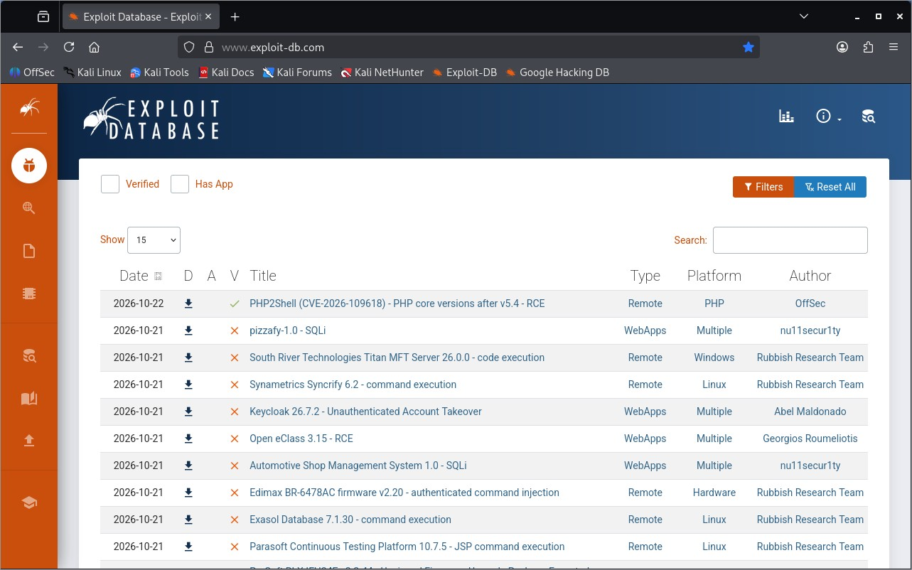
*Figure 2.1 – Exploit-DB home*

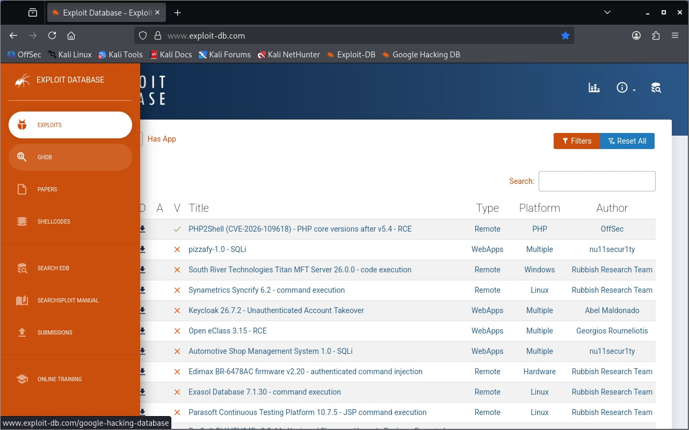
*Figure 2.2 – Navigating to GHDB*

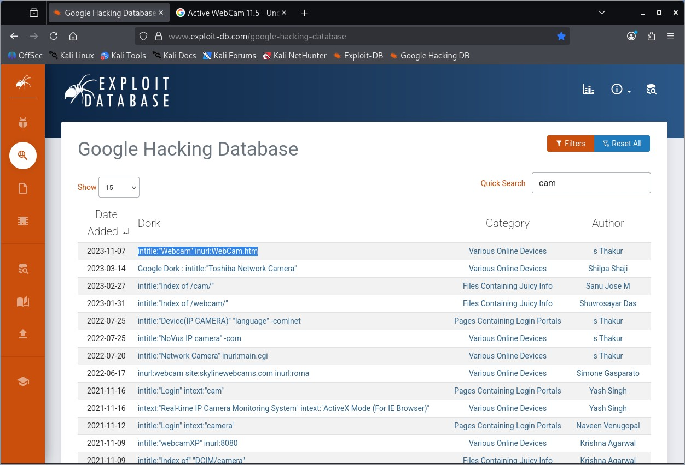
*Figure 2.3 – GHDB quick search for "cam"*

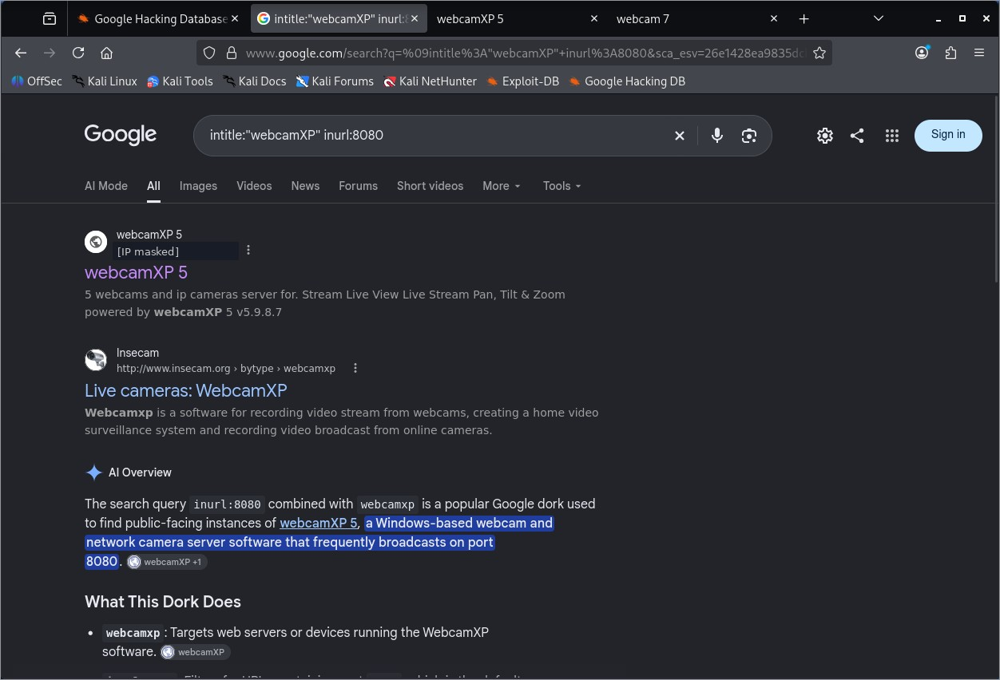
*Figure 2.4 – Dork webcamXP (IP masked)*

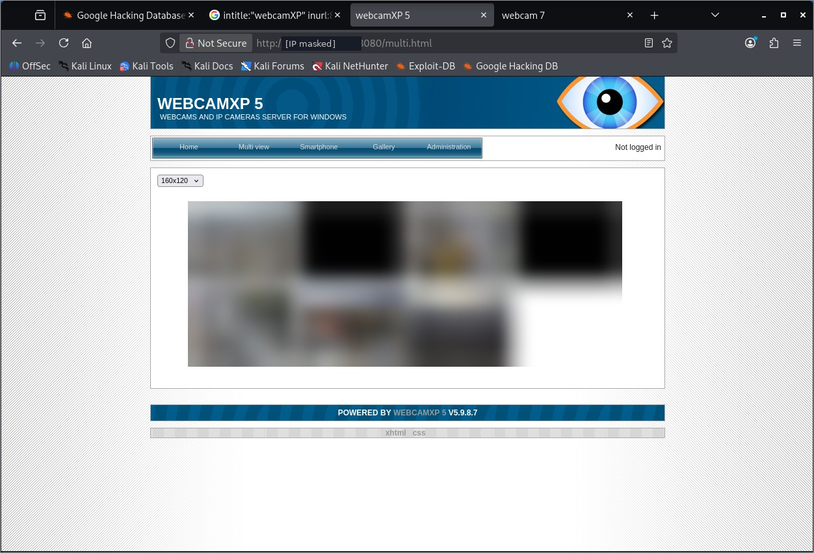
*Figure 2.5 – Exposed webcamXP 5 (IP masked, feed blurred)*

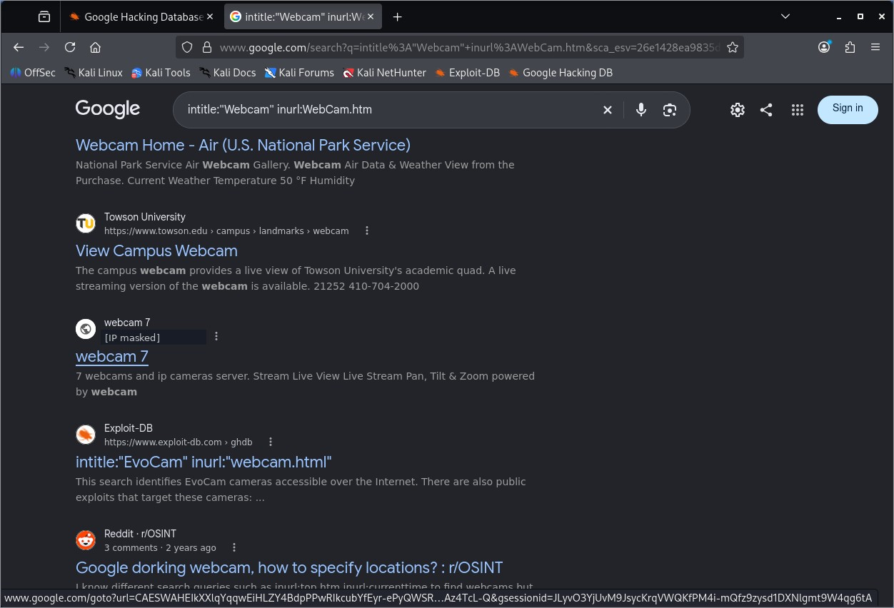
*Figure 2.6 – Related dork results (IP masked)*

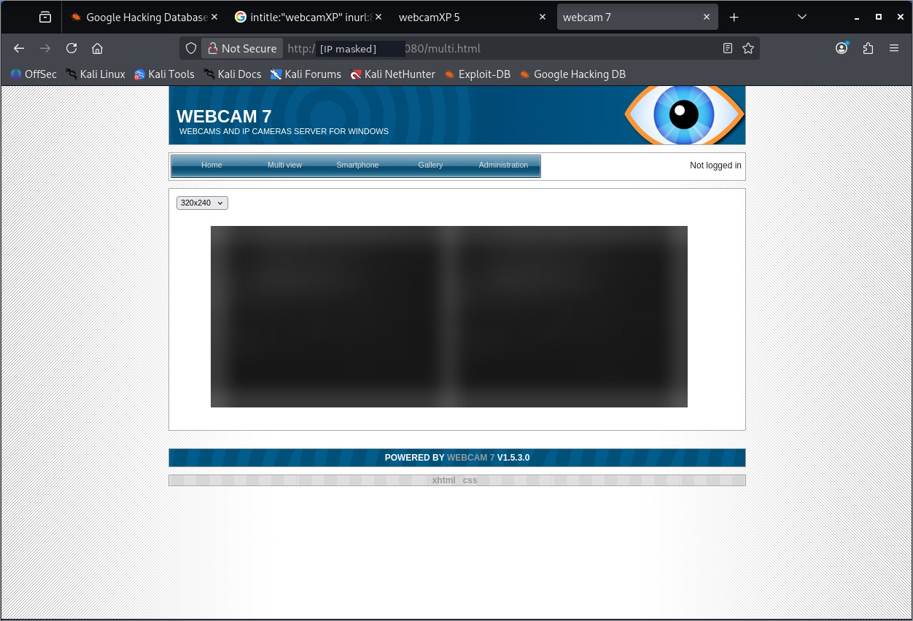
*Figure 2.7 – Exposed Webcam 7 (IP masked, feed blurred)*

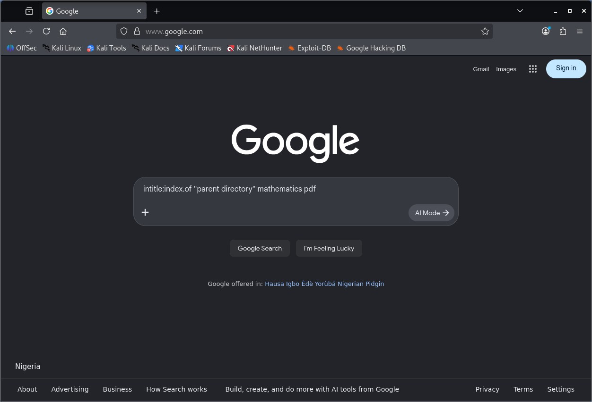
*Figure 2.8 – Directory dork entered*

*Figure 2.9 – Directory dork results*

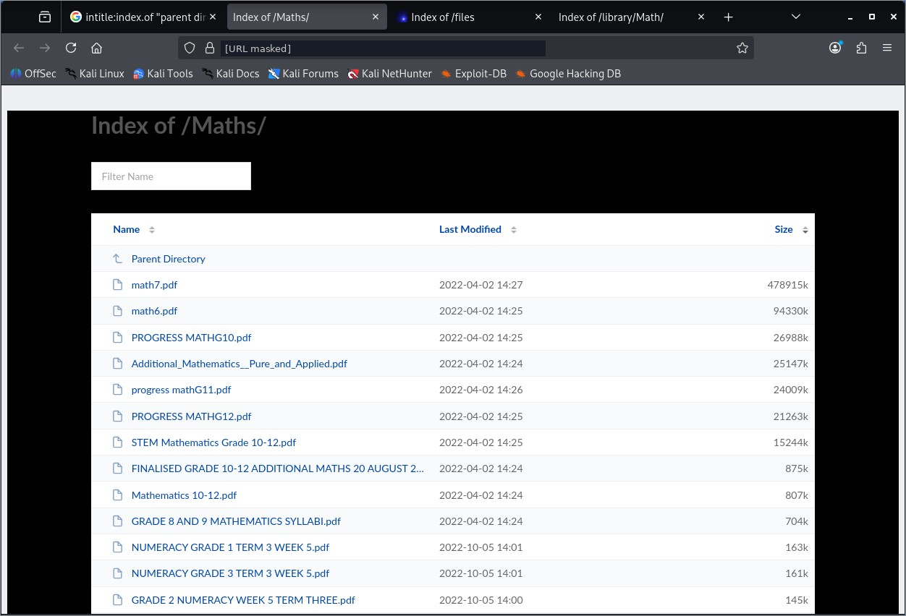
*Figure 2.10 – Open directory 1 (URL masked)*

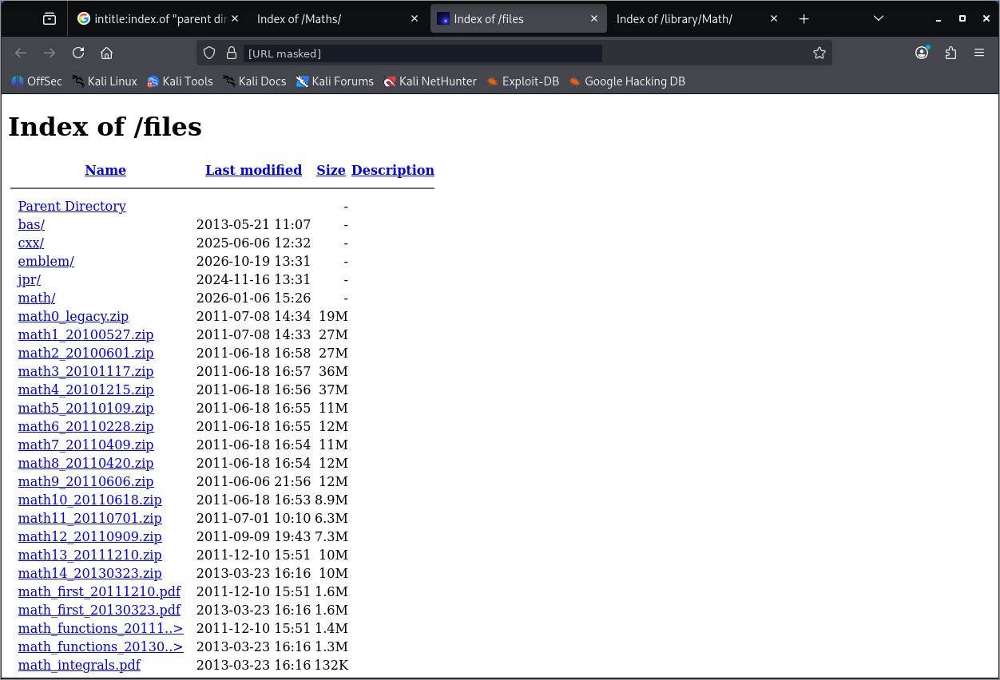
*Figure 2.11 – Open directory 2 (URL masked)*

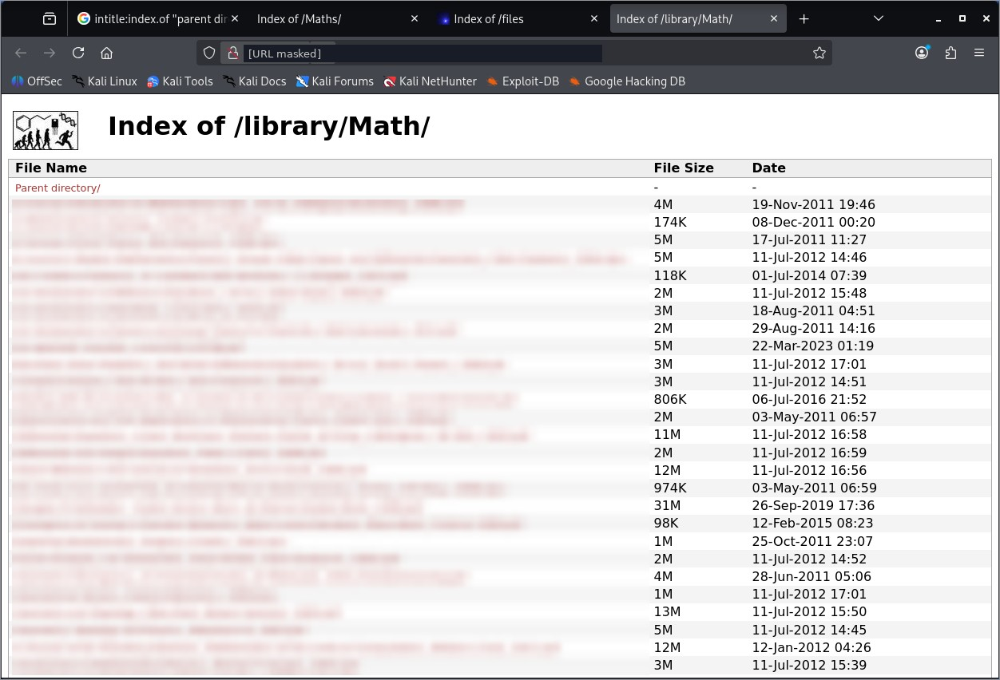
*Figure 2.12 – Open directory 3 (URL masked, names blurred)*
