# Module 3 – Footprinting with Maltego CE

**Target:** networkwalks.com (written authorization) · **Date:** 8 Nov 2026
**Tool:** Maltego CE 4.13.0 (Kali package `maltego 4.13.0-0kali1`, OpenJDK 11), free Maltego ID.

## What I did
1. Installed with `sudo apt install maltego`, launched from the terminal and activated through the browser.
2. Downloaded data sources: 238 transforms, 245 entities, 14 machines.
3. Created a blank graph, added a **Domain** entity and renamed it `networkwalks.com`.
4. Ran **[Utilities] To Emails @domain [Search Engine]** (Google-powered, so passive), once normally and once with *Extract URLs* enabled.

## Result
One address, **info@networkwalks.com**, linked to a public Networkwalks Academy login-help page. WhatWeb found the same address in Module 1. No personal staff emails or names surfaced. Scope was deliberately limited to email harvesting on the authorized domain. CE credit limits apply (180 credits remained).

## Takeaways
A role mailbox is a normal public contact but a phishing target; combined with soft-fail SPF it makes spoofing easier. Prefer a contact form and enforce email authentication.

## Evidence
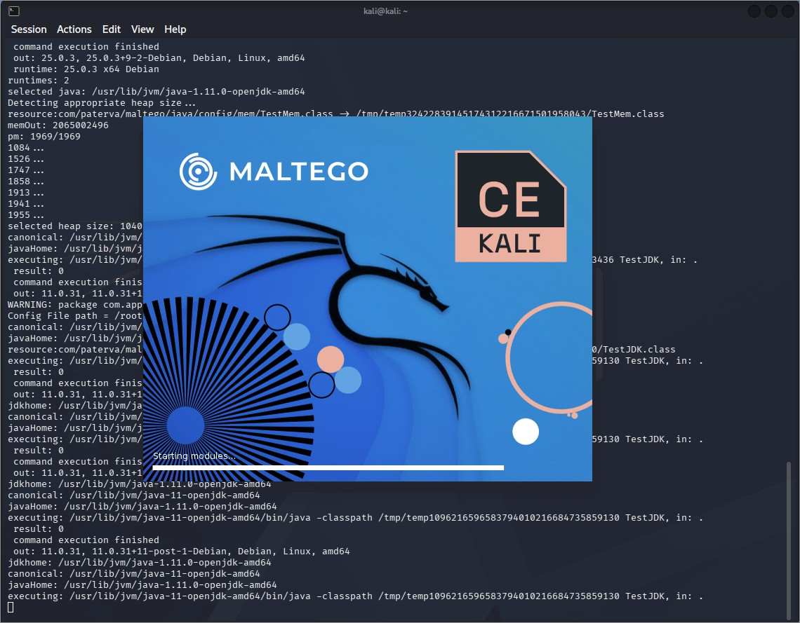
*Figure 3.3 – Maltego CE (Kali) launch*

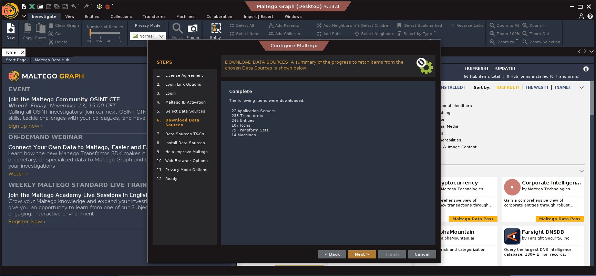
*Figure 3.10 – Data sources downloaded*

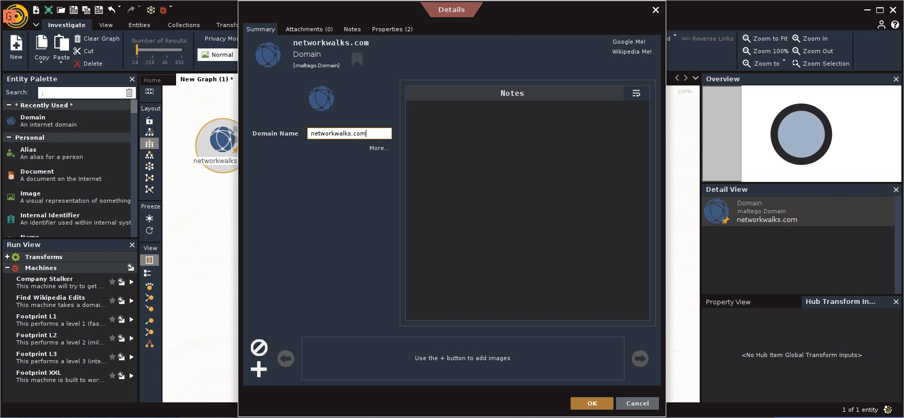
*Figure 3.14 – Domain entity renamed*

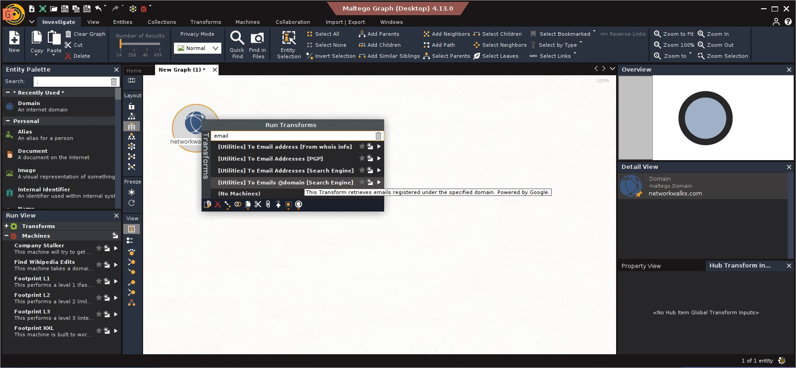
*Figure 3.15 – Transform search*

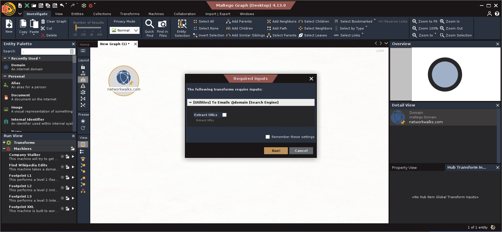
*Figure 3.16 – Transform inputs*

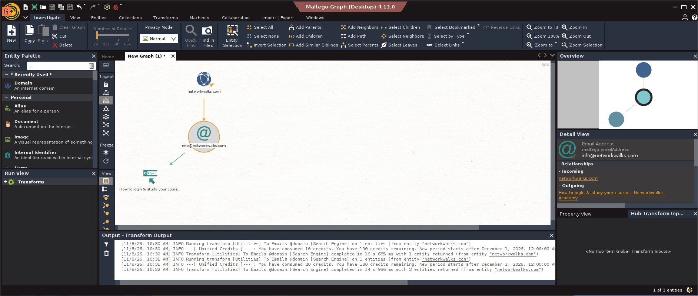
*Figure 3.17 – Results graph*

### Setup screenshots
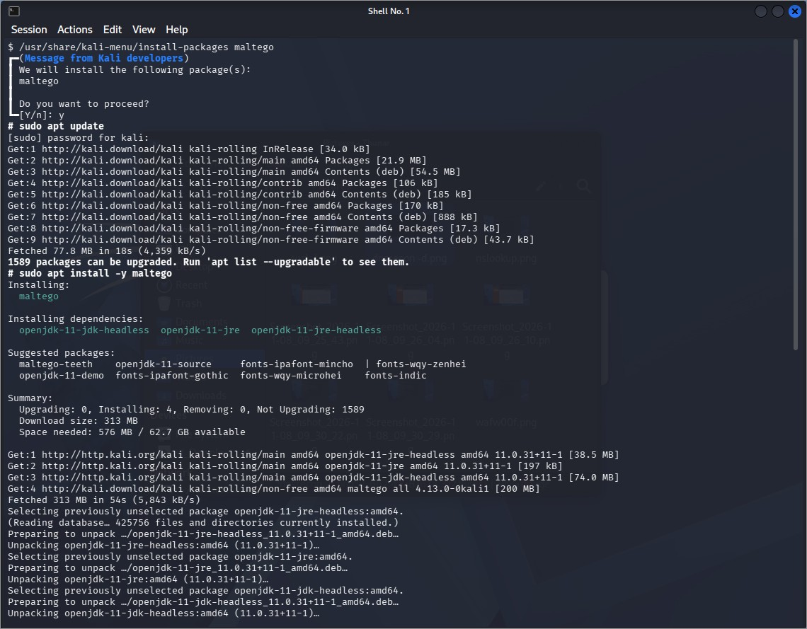
*Figure 3.1 – apt install*

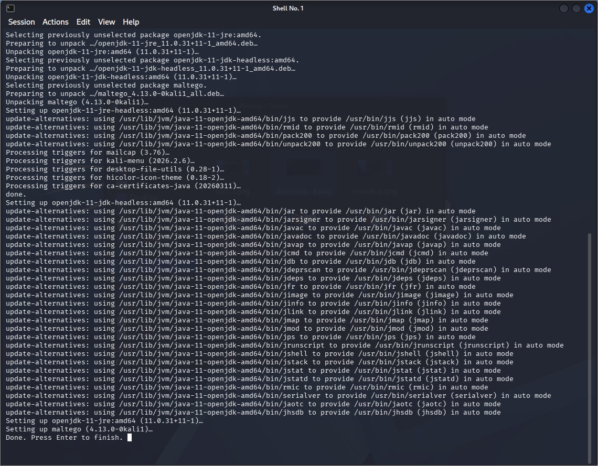
*Figure 3.2 – Install complete*

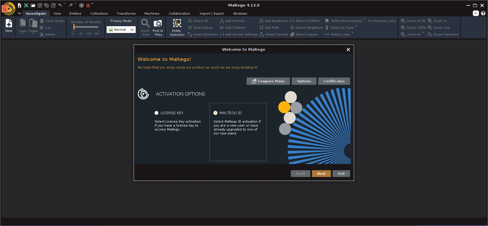
*Figure 3.4 – Activation options*

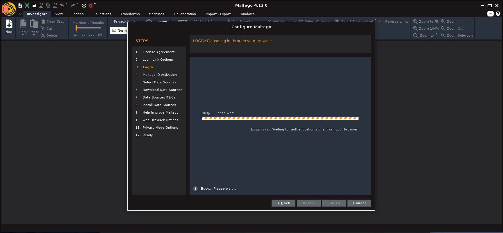
*Figure 3.5 – Browser login*

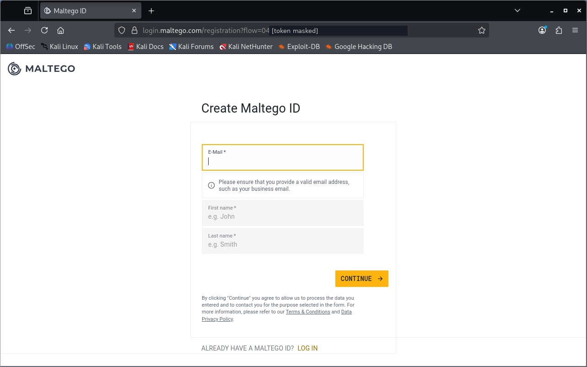
*Figure 3.6 – Create Maltego ID (token masked)*

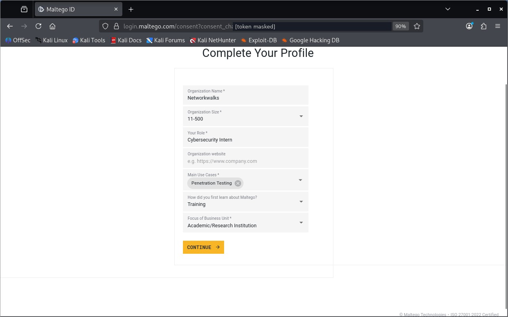
*Figure 3.7 – Complete profile (token masked)*

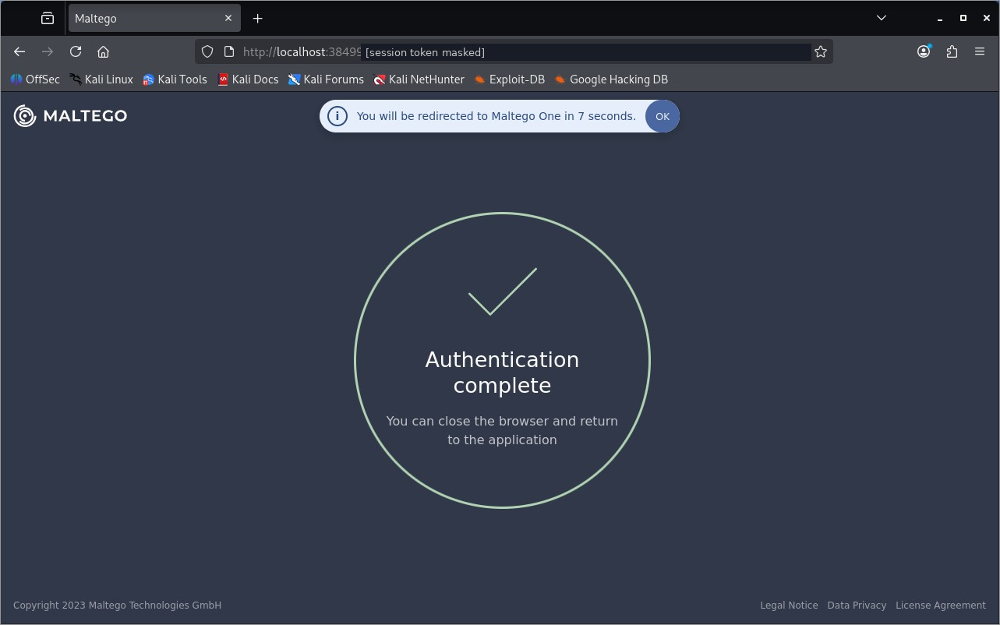
*Figure 3.8 – Authentication complete (token masked)*

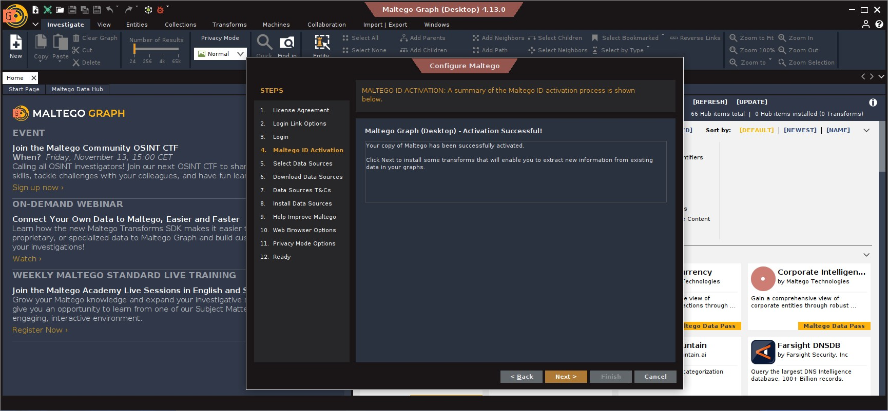
*Figure 3.9 – Activation successful*

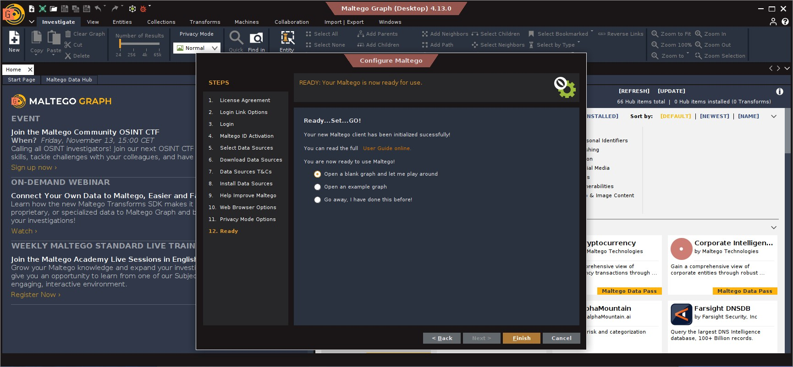
*Figure 3.11 – Client ready*

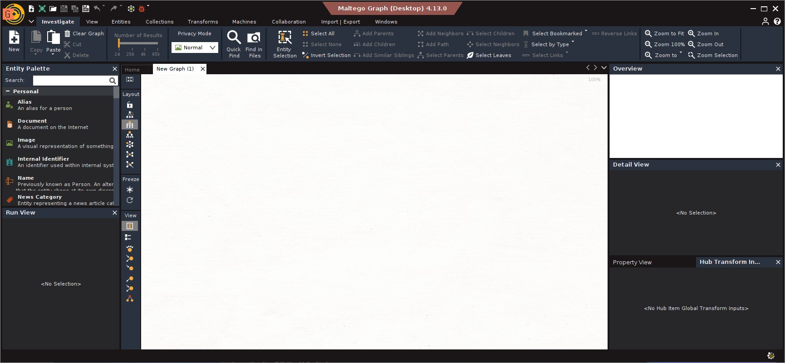
*Figure 3.12 – Blank graph*

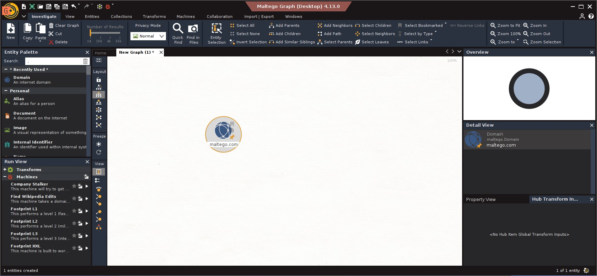
*Figure 3.13 – Domain entity placed*
