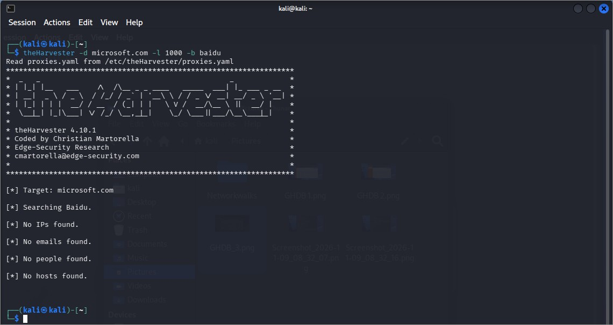
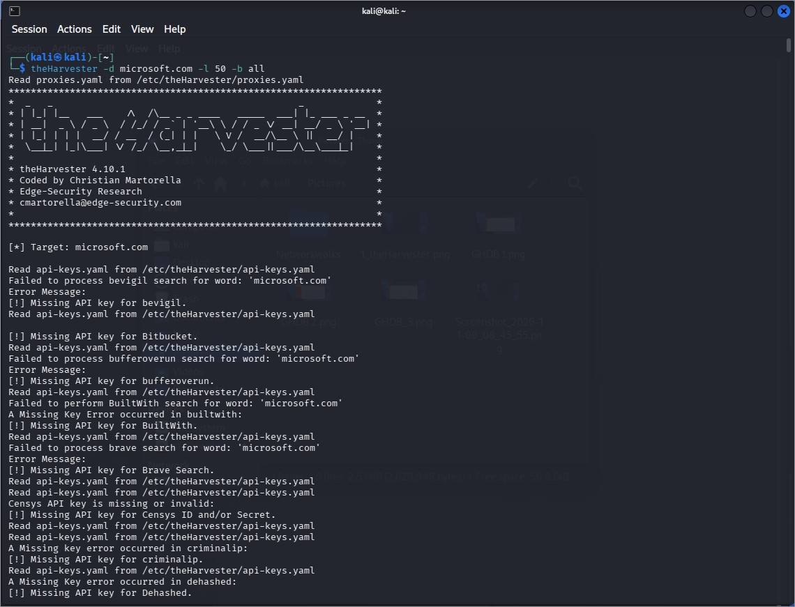
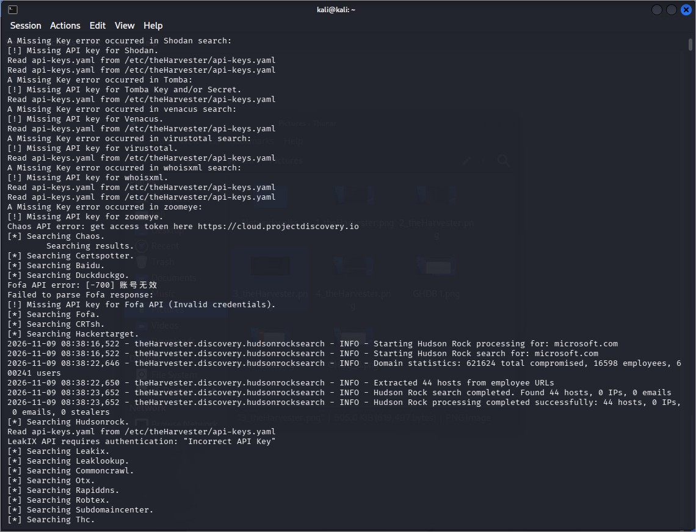
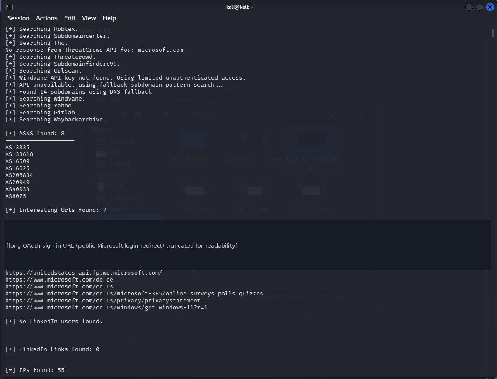

# Module 4 – Footprinting with theHarvester

**Target:** microsoft.com (lab-designated public example) · **Date:** 9 Nov 2026 · **Tool:** theHarvester 4.10.1
Public sources only; one fallback module also made light DNS lookups. Raw output (a ~10,000-line text file) is **not** committed; see [`results-summary.md`](results-summary.md).

| Task | Command | Result |
|------|---------|--------|
| 1 | `theHarvester -d microsoft.com -l 1000 -b baidu` | No IPs, emails, people or hosts found (cause not verified). |
| 2 | `theHarvester -d microsoft.com -l 50 -b all` | 9,967 hosts, 55 IPs, 8 ASNs, 7 URLs, 3 role/bot emails. 32 sources unavailable (missing or invalid API keys). |

## Takeaways
Passive OSINT can map a large organization without touching it. Results depend heavily on API keys, so they are a lower bound. Defenders should keep an asset inventory, avoid descriptive pre-production hostnames, monitor certificate transparency and watch for infostealer exposure.

## Evidence

*Figure 4.1 – Task 1 – Baidu, no results*

*Figure 4.2 – Task 2 – command and missing API keys*

*Figure 4.3 – Task 2 – sources and Hudson Rock output*

*Figure 4.4 – Task 2 – summary (long OAuth URL truncated)*
