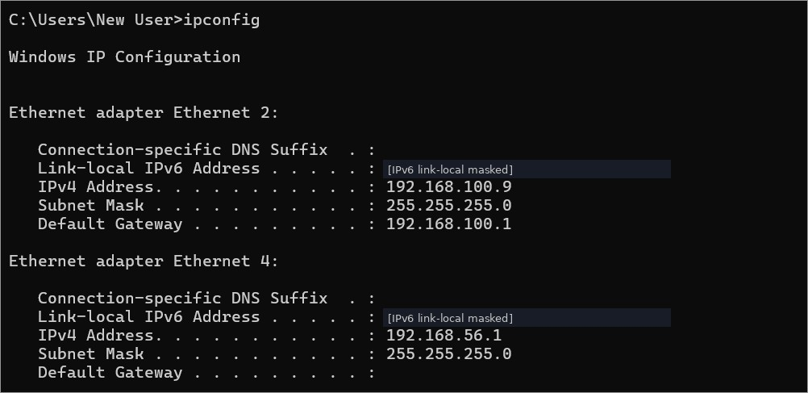
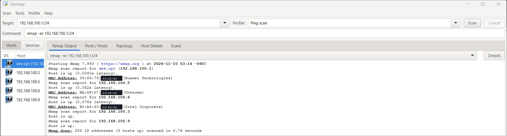
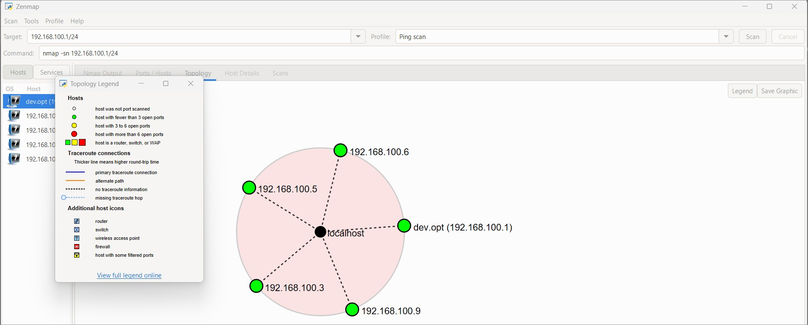
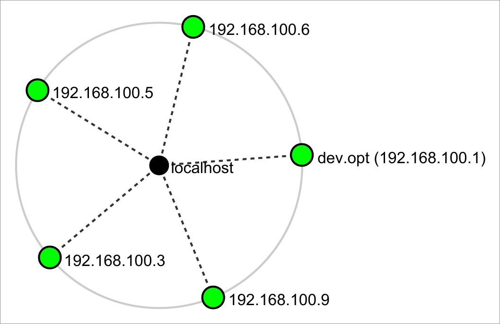
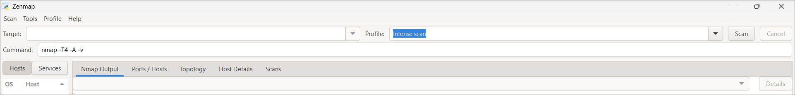

# Module 5 – Network Scanning with Zenmap

**Target:** my own LAN, 192.168.100.0/24 · **Date:** 10 Nov 2026 · **Tool:** Zenmap / Nmap 7.993 on Windows

## What I did
1. `ipconfig` showed IPv4 192.168.100.9, mask 255.255.255.0, gateway 192.168.100.1.
2. Zenmap, **Ping scan** profile: `nmap -sn 192.168.100.1/24`.
3. Result: **5 hosts up out of 256 addresses in 6.74 s.**
4. Enabled the Topology legend and saved the graph as PDF ([`evidence/5.4-topology-export.pdf`](evidence/5.4-topology-export.pdf)).

| Host | MAC (masked) | Vendor | Notes |
|------|--------------|--------|-------|
| 192.168.100.1 (dev.opt) | 34:66:79:xx:xx:xx | Huawei Technologies | Default gateway |
| 192.168.100.3 | not reported | – | Typical of an address local to the scanning machine |
| 192.168.100.5 | BA:6F:D7:xx:xx:xx | Unknown | Locally administered bit set (randomized MAC); identification under way |
| 192.168.100.6 | B0:A4:60:xx:xx:xx | Intel Corporate | |
| 192.168.100.9 | not reported | – | The scanning PC |

## Takeaways
Any LAN device can discover the same hosts in seconds. Randomized MACs defeat vendor lookup, so use DHCP leases and device names for inventory. Segment guest and IoT devices and scan periodically.

## Evidence

*Figure 5.1 – ipconfig (IPv6 masked)*

*Figure 5.2 – Ping scan results (MAC suffixes masked)*

*Figure 5.3 – Topology view with legend*

*Figure 5.4 – Topology export*

*Figure 5.5 – Zenmap launch state*
